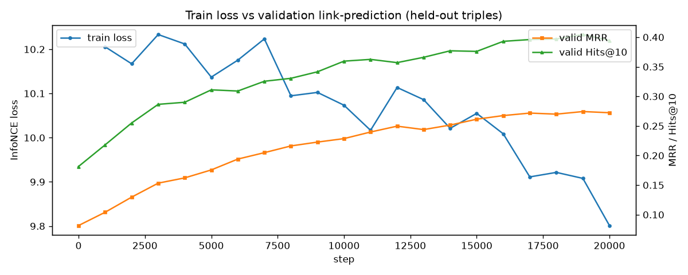
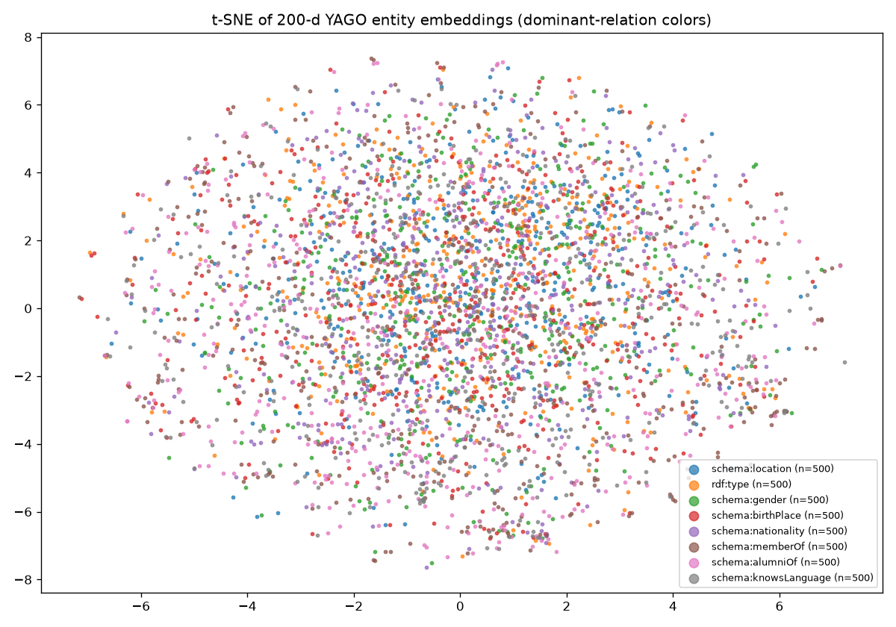
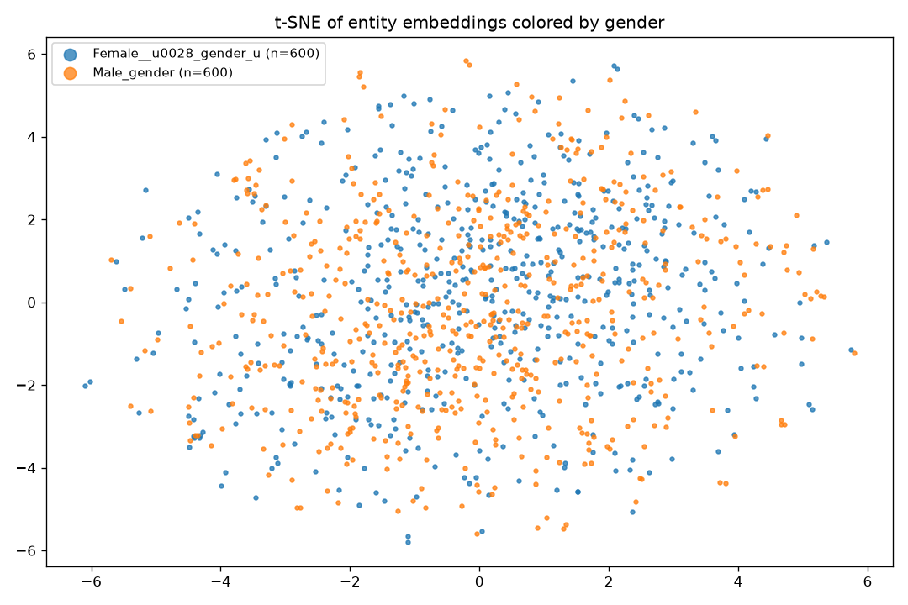
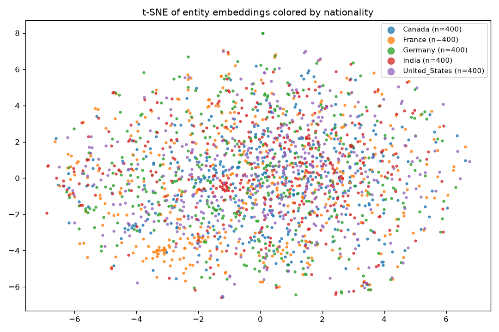
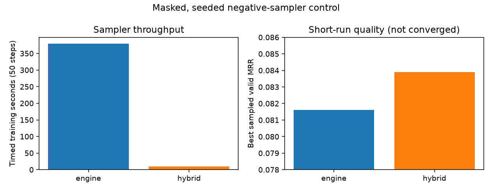
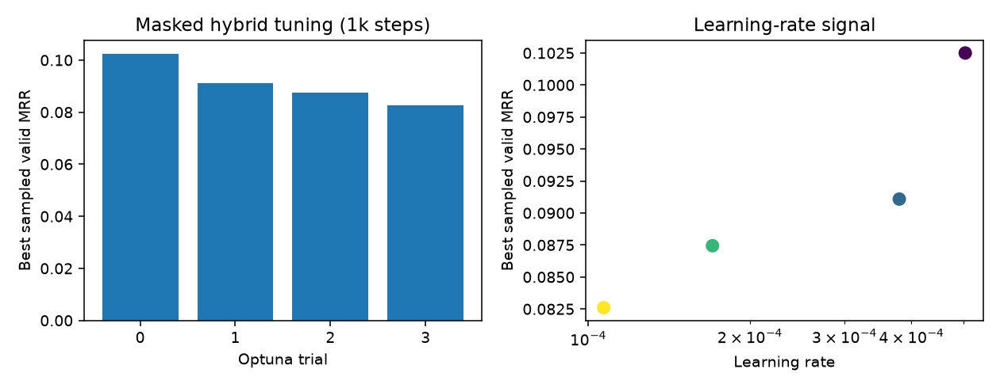
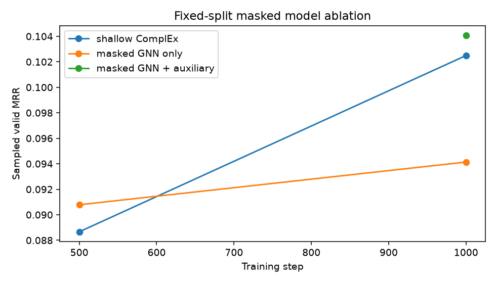

# YAGO 4.5 Knowledge-Graph Embeddings (gestaltdb + tf_gnns)

High-performance TensorFlow training pipeline that ingests the YAGO 4.5 graph into
[GestaltDB](https://github.com/mylonasc/gestaltdb), serves micro-batches from a
reusable CSR sampler snapshot, encodes them with a compiled
[tf_gnns](https://github.com/mylonasc/tf_gnns) message-passing network, and trains
200-dimensional entity (and relation) embeddings with an in-batch contrastive
(GNN-autoencoder style) loss.

Detailed lessons from this work—including correctness, sampling, semantic
geometry, KG completion, and inductive inference—are collected in
[`docs/`](docs/README.md).

For **unseen-entity GNN link prediction**, use the new independent
[inductive autoencoder pipeline](docs/09-inductive-autoencoder.md). It trains an
ID-independent relational encoder and ComplEx decoder, also exports useful
shallow KGE embeddings, and supports full checkpoint resume and contextual GNN
evaluation on entity-held-out support/query splits. Existing runs remain unchanged.

## Result

- `data/yago45/artifacts/yago45_embeddings_200d.npz`:
  - `entity_base_200d`: `[num_entities, 200]` float32 — base KGE entity table
  - `relation_base_200d`: `[num_relations, 200]` float32 — matching KGE relation table
  - `node_ids`, `relation_ids`: external ID maps (row-aligned with the matrices)
- `artifact_metadata.json`: scorer and representation metadata used by evaluation
- `relation_retrieval_report.json`: primary `(subject, relation, ?)` KGE examples
- `cosine_diagnostic.json`: raw cosine neighbors, explicitly diagnostic only
- `data/yago45/artifacts/checkpoints/`: training checkpoints

This run: official `yago-4.5.0.2-tiny` distribution (23.2M Turtle lines) filtered to
**351,934 entity–entity triples / 299,739 entities / 57 relations**. The pipeline
streams from the `.zip` without extracting it, so the same commands scale to the
full `yago-4.5.0.2.zip` via `--ttl` (see "Scaling to full YAGO").

Two trained artifacts are produced in this repo:
- `data/yago45/artifacts/yago45_embeddings_200d.npz` — tiny-graph run
  (300k entities x 200, 57 relations x 200; 5k steps; loss 2.20 -> ~1.0;
  MRR 0.089 / Hits@10 0.20 @ 50 negatives).
- `data/yago45_facts/artifacts/yago45_embeddings_200d.npz` — facts-scale run on
  `yago-facts.ttl` (all YAGO 4.5 entities with an English Wikipedia page):
  **12.0M train triples / 4.18M entities / 25 relations** (stratified
  per-relation cap 1M) + 10k held-out valid + 10k held-out test, 150k steps
  (~7 steps/s; **valid sampled MRR 0.088 -> 0.473**;
  **test sampled MRR 0.467 / Hits@1 0.38 / Hits@10 0.62** @ 50 negatives).
  Entity matrix ~3.2GB. Train/validation curves: `artifacts/curves.jsonl`,
  `artifacts/curves.png`.

These are **historical pre-fix metrics**, retained for reproducibility. That run
included each supervised seed edge in the GNN context and its evaluation did not
actually filter other known objects due to an incorrect dictionary lookup. The
current code masks seed/reverse edges and fixes sampled filtering; do not compare
new masked runs to the historical number as if the protocol were unchanged.
Re-evaluating the old artifact with corrected filtering produced the same rounded
sampled metrics (known-positive collisions are rare among 50 uniform draws).

Corrected masked-run curves (20k steps), dominant-relation t-SNE, and
class-conditioned t-SNE:






## Method

- **Model (GNN-autoencoder, ComplEx decoder):** trainable entity table
  `[N, 200]` + relation table `[R, 200]` (+ small node-type table); linear
  projections to 256-d; 2-step `tf_gnns.GraphNetMPNN_MLP` encoder; ComplEx triple
  scoring. Exact labelled edges are masked from message passing. The exported
  200-d base tables receive a separate, matching shallow ComplEx objective.
- **Loss:** contextual InfoNCE plus weighted shallow-table InfoNCE; optional
  self-adversarial negative weighting.
- **Negatives:** GestaltDB `SamplerEngine.sample_subgraph` with
  `HardNegativeConfig(context_relation_neighbors, reject_known_positives,
  same_endpoint_type)` — hard, type-consistent, filtered negatives.
- **Compilation:** application-level `@tf.function(input_signature,
  reduce_retracing=True)` over the whole `train_step` (GNN + loss + optimizer);
  optional `--xla` for `jit_compile=True`. Library internals stay eager/backend-portable.
- **Feeding:** array-backed CSR snapshot (`SamplerSnapshot.from_edge_arrays`,
  `mode="ram"`) — no KV reads in the hot path; `tf.data.Dataset.from_generator`
  with explicit output signature + `.prefetch(4)`.

## Setup

```bash
python3 -m venv .venv
./.venv/bin/pip install -r requirements.txt
# or use editable local checkouts for tf_gnns / gestaltdb
```

`scripts/*.sh` set `KERAS_BACKEND=tensorflow` and extend `LD_LIBRARY_PATH` with the
pip `nvidia` CUDA libs so TensorFlow sees the GPU (same trick as
`gestaltdb/example/gnn_kg/run_training.sh`).

## Pipeline

```bash
# 1. Parse YAGO Turtle -> parquet shards -> maps/arrays -> GestaltDB ingest -> CSR snapshot
bash scripts/prepare.sh --reset-db
# 2. Smoke test (10 steps, tiny model)
bash scripts/train.sh --smoke-test
# 3. Full training (default: 5000 steps, batch 64, 8 hybrid negatives)
bash scripts/train.sh --steps 5000 --batch-size 64
# Resume an interrupted run to a total of 5000 steps (same run directory)
bash scripts/train.sh --steps 5000 --batch-size 64 --resume
# 4. Relation-conditioned link prediction (sampled-filtered MRR / Hits@k)
./.venv/bin/python -m yago.eval --triples 2000 --negatives 50
# 5. Serve demo
./.venv/bin/python -m yago.serve --k 5 --score distmult  # --score only for legacy artifact
```

HOLD-OUT PROTOCOL: triples are split into train/valid/test at
prepare time (`--valid-size`, `--test-size`, default 10k each; endpoints must
occur >= 3x so held-out entities stay observable). The GestaltDB ingest and CSR
snapshot are built from TRAIN ONLY. During training, `valid_mrr`/`valid_hits10`
are logged every `--eval-every` steps to `artifacts/curves.jsonl` (+ `curves.png`);
final numbers come from `yago/eval.py` on the held-out TEST split with a
sampled-filtered protocol. Exact supervised seed edges (and same-relation
reverse copies) are removed from each GNN message graph.

Useful flags: `prepare.sh --ttl <file.zip|file.ttl> --limit-lines N --min-relation-edges K
--target-edges M --max-edges-per-relation C --valid-size V --test-size T
--skip-ingest --skip-parse`; `train.sh --negative-sampler {engine,hybrid} --negatives 16
--learning-rate 3e-4 --workers 0 --eval-every 2000 --xla --allow-cpu --resume`.

Checkpoints contain the model, optimizer, and completed-step counter. `--resume`
loads the latest checkpoint from `<run-dir>/checkpoints`, preserves curve history,
and interprets `--steps` as the target total rather than additional steps.

`engine` uses GestaltDB's filtered, endpoint-type-aware hard negatives. `hybrid`
uses local corruptions for contextual GNN states and genuinely global entity IDs
for the exported-table auxiliary loss. For tracked tuning, Optuna stores every
trial in SQLite and separate run directories:

```bash
bash scripts/optuna.sh --data-root data/yago45_facts \
  --study-dir data/yago45_facts/optuna/masked-kge --trials 8 --steps 5000
```

The same persistent workflow can tune a warm-started semantic objective while
holding the validated KGE recipe fixed:

```bash
bash scripts/optuna.sh --data-root data/yago45_facts \
  --study-dir data/yago45_facts/optuna/semantic \
  --semantic-search --objective combined --finetune-recipe --model-variant shallow \
  --sampler-search hybrid --init-embeddings /path/to/yago45_embeddings_200d.npz
```

For a selected recipe, `train.py` accepts `--init-embeddings`, `--seed`,
`--semantic-weight`, `--semantic-temperature`, `--semantic-batch-size`, and
`--semantic-negatives`. Quantify the resulting generic cosine geometry with:

```bash
./.venv/bin/python -m yago.semantic_eval --data-root data/yago45_facts \
  --embeddings /path/to/yago45_embeddings_200d.npz --output /path/to/semantic_eval
```

## Performance (RTX 4090, this repo)

| Stage | Throughput |
|---|---|
| Turtle parse (23.2M lines, streamed from zip) | ~350k entity–entity triples kept |
| GestaltDB RocksDB ingest (300k nodes + 352k edges) | ~1.5 s (~430k records/s) |
| Sampler, hard negatives (batch 64, 2-hop 12/8) | ~2.3 batches/s (rejection loop bound) |
| Sampler, hybrid negatives (batch 64, 2-hop 12/8) | ~30 batches/s (33 ms/batch) |
| End-to-end training, hybrid negatives (compiled `train_step`) | ~8 steps/s (~500 triples/s) |
| Smoke (batch 8, 1 MP step) | ~60 steps/s |

Masked, seeded 50-step control (batch 128, 16 negatives, identical recipe):
GestaltDB hard negatives reached sampled valid MRR 0.0816 and required about
7 minutes; hybrid reached 0.0839 and required 51 seconds end-to-end (9.3 seconds
inside the timed training loop). This short run is a throughput decision, not a
claim about converged quality; longer tuning therefore uses hybrid sampling.



Machine-readable values: `experiments/masked_negative_control.csv`.

Four 1,000-step hybrid Optuna trials selected LR `5.04e-4`, batch 128,
16 negatives, adversarial temperature `1.414`, and auxiliary weight `1.003`
(best sampled valid MRR `0.1025`). Full trial data is in
`experiments/optuna_masked_hybrid_1k.csv`.



At an equal 1,000-step budget, shallow ComplEx reached MRR `0.1025`, masked
GNN-only `0.0941`, and masked GNN + auxiliary `0.1041`. The auxiliary objective
is therefore essential for the exported base tables; the contextual GNN adds
only a small base-table gain at this short budget.



The Optuna-best masked run reached best validation MRR `0.2743` at 19k steps.
Corrected test evaluation at 20k gives:

| Candidate policy (50 negatives) | MRR | Hits@1 | Hits@10 |
|---|---:|---:|---:|
| Uniform sampled-filtered | 0.2770 | 0.2005 | 0.4080 |
| Relation-range sampled-filtered | 0.2198 | 0.1330 | 0.3765 |

Relation-range negatives are sampled from objects observed with the predicate,
making them substantially harder and more informative than global uniform draws.
The published run record is in `experiments/masked_20k_metadata.json`,
`experiments/masked_20k_curves.jsonl`, and
`experiments/masked_20k_relation_retrieval.json`. The 3.2GB embedding matrix is
intentionally not stored in Git.

Feed-side is sampler-bound (expected: 2-hop expansion + filtered hard negatives
per batch). Knobs: smaller fanouts, fewer negatives, larger prefetch, and (code-ready)
thread-pooled prefetch around `sample_batch`.

Use the included feed/compute benchmark rather than GPU-memory occupancy alone:

```bash
./.venv/bin/python -m yago.bench_feed --data-root data/yago45_facts \
  --mode all --batches 30 --batch-size 256 --workers 4
```

Compact semantic run records are under `experiments/`; see
[`experiments/README.md`](experiments/README.md). Large embedding tables and
checkpoints remain intentionally excluded.

## Layout

- `yago/config.py` — all hyper/config (embedding dims: entity 200 / relation 200)
- `yago/parse.py` — streaming Turtle -> entity-entity parquet shards
- `yago/prepare.py` + `yago/prepare_cli.py` — maps, arrays, GestaltDB ingest, snapshot
- `yago/sampler.py` — `YagoSampler` (CSR + hard negatives) -> `tf.data` batch dicts
- `yago/model.py` — `YagoKGEModel` (tf_gnns MPNN + ComplEx scorer)
- `yago/losses.py`, `yago/train.py`, `yago/eval.py`, `yago/export.py`
- `yago/optuna_search.py` — persistent isolated KGE/semantic hyperparameter search
- `yago/semantic_eval.py` — balanced cosine metrics and reproducible t-SNE plots
- `yago/bench_feed.py` — feeder, delivery, compute, and end-to-end throughput
- `scripts/prepare.sh`, `scripts/train.sh`, `scripts/optuna.sh` — GPU entry points
- `notebooks/01_yago45_embeddings_notes.ipynb` — notes + visualizations
  (relation stats, t-SNE, relation-conditioned retrieval, cosine diagnostic);
  regenerate with `notebooks/gen_notebook.py`, execute with nbconvert or Jupyter;
  set `YAGO_RUN_ARTIFACTS=/path/to/run` to analyze a non-default training run
- `data/yago45/` — downloads, shards, artifacts, DB, snapshot
- `PLAN.md` — build log

## Scaling to full YAGO 4.5

```bash
curl -L -o data/yago45/yago-4.5.0.2.zip https://yago-knowledge.org/data/yago4.5/yago-4.5.0.2.zip
# facts = entities with an EN Wikipedia page (23GB Turtle, streamed from zip)
bash scripts/prepare.sh --ttl data/yago45/yago-4.5.0.2.zip --ttl-member yago-facts.ttl \
  --data-root data/yago45_facts --reset-db \
  --min-relation-edges 50 --max-edges-per-relation 500000 --target-edges 8000000
bash scripts/train.sh --data-root data/yago45_facts --steps 8000 --batch-size 64 \
  --hop1-fanout 8 --hop2-fanout 4
```

The parser streams from the zip (no extraction). For 10s of millions of triples,
raise `--min-relation-edges`, keep `--target-edges` unset, and consider a machine
with >64GB RAM for the CSR snapshot + a multi-GB embeddings artifact
(49M entities x 200 x 4B ≈ 39GB uncompressed at full scale).
