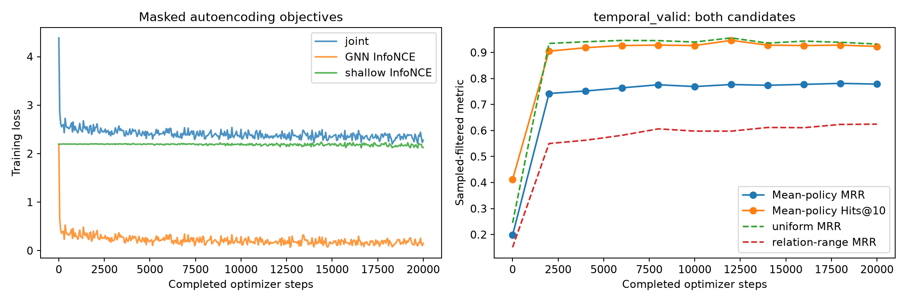
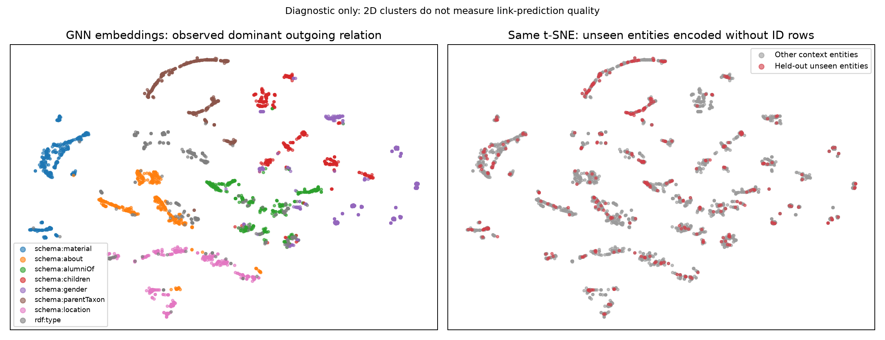
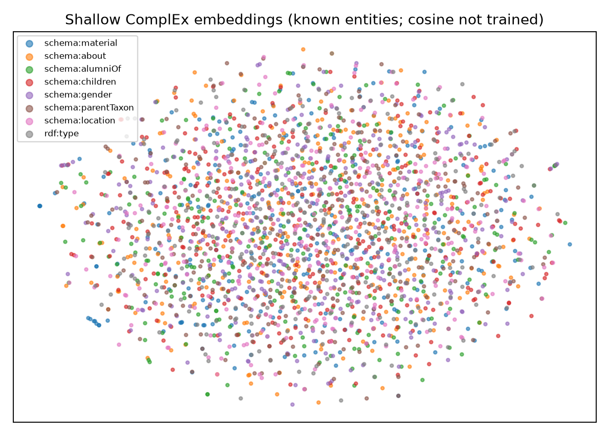

# Inductive YAGO graph-autoencoder results

Validation-selected checkpoint: `../data/yago45_full/inductive_full_mixed/best/ckpt-18000`.

All test metrics below are sampled-filtered tail prediction, not full ranking.

| Test model / candidate policy | MRR | Hits@1 | Hits@10 |
|---|---:|---:|---:|
| untrained_uniform | 0.2739 | 0.1685 | 0.4960 |
| trained_uniform | 0.9786 | 0.9690 | 0.9935 |
| untrained_relation-range | 0.1978 | 0.0930 | 0.4380 |
| trained_relation-range | 0.8641 | 0.7995 | 0.9700 |
| no_message_relation_range | 0.7944 | 0.7085 | 0.9405 |

## Chronological valid-time completion

Known-entity queries starting in 2019–2024; training-dated facts through 2010, validation 2011–2018.
Undated static background is allowed: this is not causal knowledge-acquisition forecasting.

| Temporal test policy | MRR | Hits@1 | Hits@10 | Frequency MRR (expected ties) |
|---|---:|---:|---:|---:|
| uniform | 0.7984 | 0.7475 | 0.9110 | 0.8377 |
| relation-range | 0.4591 | 0.3380 | 0.7010 | 0.3917 |

## Training budget and representations

20,000 updates; 96,428,602 training facts; 0.0265 seed-draw-equivalent epochs. The entire training graph is available as context; this is not an exhaustive supervised pass.
Final shallow-table known-entity validation MRR: 0.3415.
The transferable GNN and contextual decoder are distinct from the shallow ID tables.

t-SNE labels describe observed neighborhoods and are diagnostic, not a semantic benchmark.
See summary.json for confidence intervals, frequency/random controls, per-relation and support-degree groups.

## Candidate calibration and controls

| Policy | GNN MRR | Frequency MRR (pessimistic ties) | Frequency MRR (expected ties) | Random expected MRR |
|---|---:|---:|---:|---:|
| uniform | 0.9786 | 0.9618 | 0.9646 | 0.0886 |
| relation-range | 0.8641 | 0.7753 | 0.7764 | 0.0920 |

## Complete all-node static GNN cache

49,281,921 × 200 float16 vectors (19.7 GB), stored outside Git at `data/yago45_full/gnn_cache/gnn_embeddings.npy`.
All values finite: True. See cache_metadata.json for completion and model/dataset identity.
Held-out queries/reverses are globally scrubbed before encoding; these batched-context results are separate from per-query inference.

| Cache candidate policy | MRR | Hits@1 | Hits@10 | Mean candidates | Frequency MRR |
|---|---:|---:|---:|---:|---:|
| uniform | 0.9787 | 0.9700 | 0.9935 | 51.000 | 0.9679 |
| relation-range | 0.8568 | 0.7880 | 0.9715 | 49.528 | 0.7799 |
| degree-matched | 0.4759 | 0.3075 | 0.8315 | 30.712 | 0.3116 |

Degree-matched candidates control incoming-predicate degree; sparse bins reduce candidate counts, so compare against that policy's own controls.
