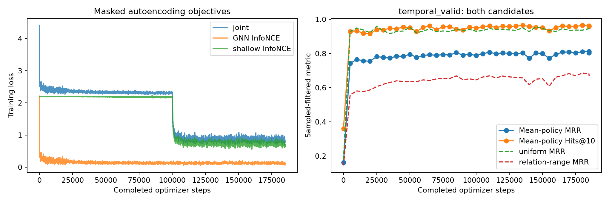
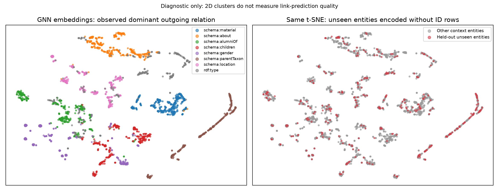
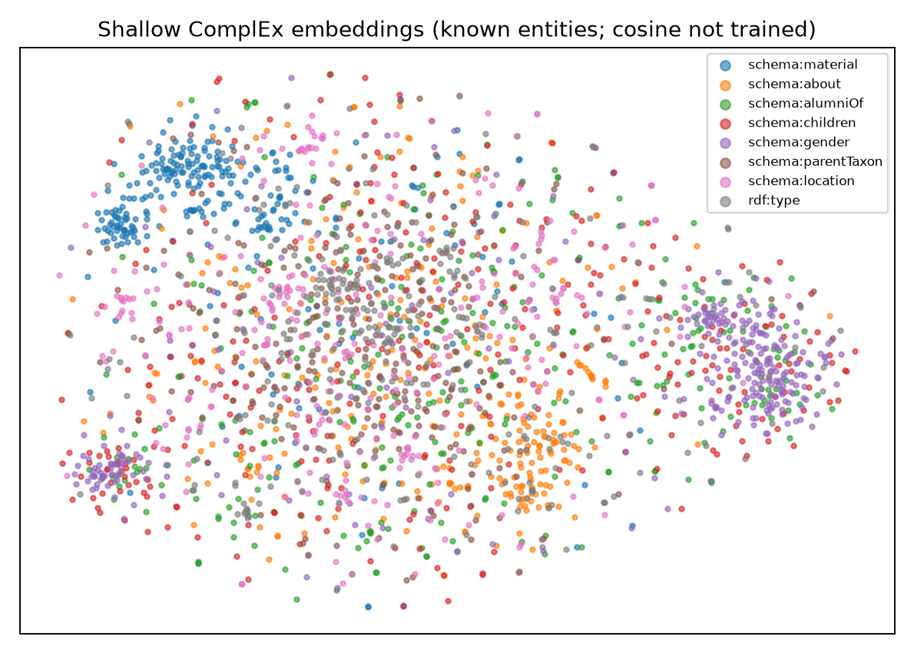

# Inductive YAGO graph-autoencoder results

Latest training checkpoint: `data/yago45_full/inductive_full_entity2_h128_mp3/checkpoints/ckpt-185111`.

All test metrics below are sampled-filtered tail prediction, not full ranking.

| Test model / candidate policy | MRR | Hits@1 | Hits@10 |
|---|---:|---:|---:|
| untrained_uniform | 0.1073 | 0.0515 | 0.1715 |
| trained_uniform | 0.9740 | 0.9605 | 0.9980 |
| untrained_relation-range | 0.0823 | 0.0285 | 0.1515 |
| trained_relation-range | 0.8869 | 0.8255 | 0.9845 |
| no_message_relation_range | 0.6756 | 0.5605 | 0.8615 |

## Chronological valid-time completion

Known-entity queries starting in 2019–2024; training-dated facts through 2010, validation 2011–2018.
Undated static background is allowed: this is not causal knowledge-acquisition forecasting.

| Temporal test policy | MRR | Hits@1 | Hits@10 | Frequency MRR (expected ties) |
|---|---:|---:|---:|---:|
| uniform | 0.8599 | 0.7860 | 0.9880 | 0.8389 |
| relation-range | 0.5826 | 0.4555 | 0.8385 | 0.3879 |

## Training budget and representations

185,111 updates; 96,428,602 training facts; 0.9015 seed-draw-equivalent epochs. The entire training graph is available as context; this is not an exhaustive supervised pass.
Final shallow-table known-entity validation MRR: 0.6339.
The transferable GNN and contextual decoder are distinct from the shallow ID tables.

Selected GNN coverage: 2 complete entity passes; 86,927,656 supervised anchor draws; minimum 2 positive endpoint appearances per training entity.
Coverage is not a convergence guarantee or a claim of two exhaustive edge epochs.

t-SNE labels describe observed neighborhoods and are diagnostic, not a semantic benchmark.
See summary.json for confidence intervals, frequency/random controls, per-relation and support-degree groups.

## Candidate calibration and controls

| Policy | GNN MRR | Frequency MRR (pessimistic ties) | Frequency MRR (expected ties) | Random expected MRR |
|---|---:|---:|---:|---:|
| uniform | 0.9740 | 0.9617 | 0.9648 | 0.0886 |
| relation-range | 0.8869 | 0.7785 | 0.7795 | 0.0920 |
