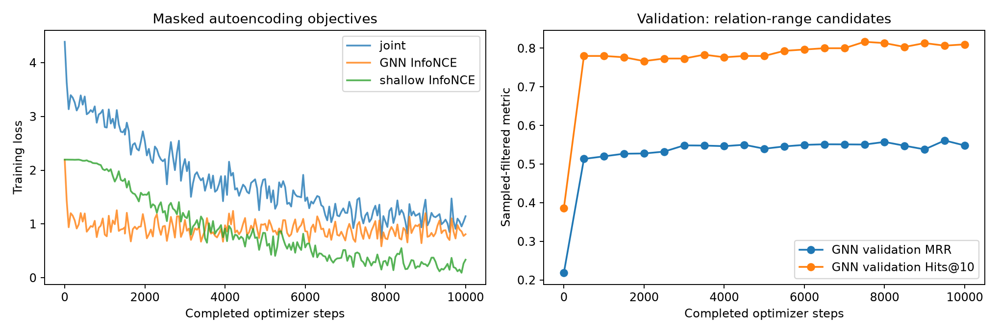
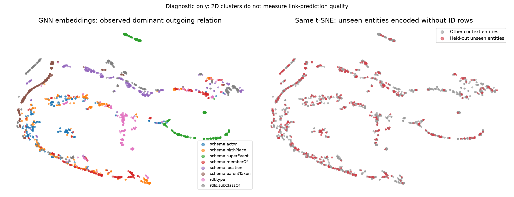
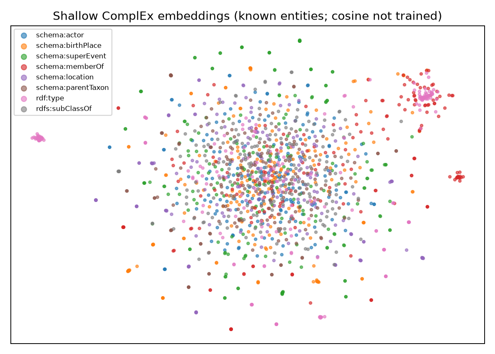

# Inductive YAGO graph-autoencoder results

Validation-selected checkpoint: `../data/yago45/inductive_optuna/trial_3/best/ckpt-9500`.

All test metrics below are sampled-filtered tail prediction, not full ranking.

| Test model / candidate policy | MRR | Hits@1 | Hits@10 |
|---|---:|---:|---:|
| untrained_uniform | 0.1578 | 0.0630 | 0.3040 |
| trained_uniform | 0.1584 | 0.1240 | 0.1700 |
| untrained_relation-range | 0.2071 | 0.1190 | 0.3770 |
| trained_relation-range | 0.5849 | 0.4560 | 0.8520 |
| no_message_relation_range | 0.5536 | 0.4250 | 0.8170 |

t-SNE labels describe observed neighborhoods and are diagnostic, not a semantic benchmark.
See summary.json for confidence intervals, frequency/random controls, per-relation and support-degree groups.

## Candidate calibration and controls

| Policy | GNN MRR | Frequency MRR (pessimistic ties) | Frequency MRR (expected ties) | Random expected MRR |
|---|---:|---:|---:|---:|
| uniform | 0.1584 | 0.7440 | 0.7623 | 0.0886 |
| relation-range | 0.5849 | 0.4417 | 0.4511 | 0.0939 |

**Limitation:** this checkpoint underperforms the frequency control on global uniform candidates. Strong relation-range results must not be presented as good candidate-independent completion. Training-negative policy and checkpoint-selection policy matter.
