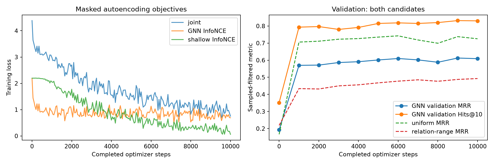
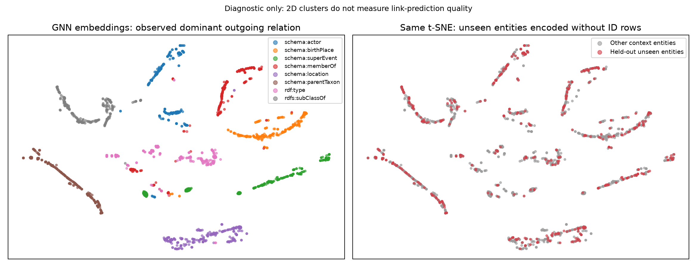
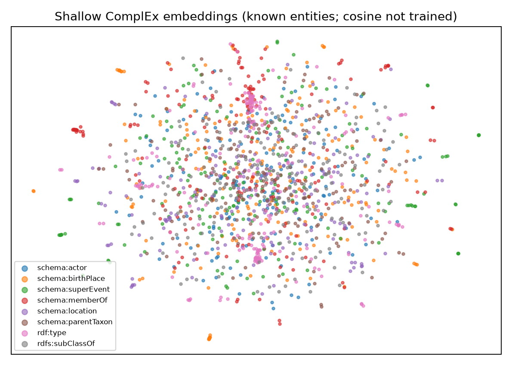

# Inductive YAGO graph-autoencoder results

Validation-selected checkpoint: `../data/yago45/inductive_mixed_balanced/best/ckpt-9000`.

All test metrics below are sampled-filtered tail prediction, not full ranking.

| Test model / candidate policy | MRR | Hits@1 | Hits@10 |
|---|---:|---:|---:|
| untrained_uniform | 0.1578 | 0.0630 | 0.3040 |
| trained_uniform | 0.7724 | 0.6860 | 0.9230 |
| untrained_relation-range | 0.2071 | 0.1190 | 0.3770 |
| trained_relation-range | 0.5378 | 0.3990 | 0.8050 |
| no_message_relation_range | 0.4471 | 0.3160 | 0.6860 |

t-SNE labels describe observed neighborhoods and are diagnostic, not a semantic benchmark.
See summary.json for confidence intervals, frequency/random controls, per-relation and support-degree groups.

## Candidate calibration and controls

| Policy | GNN MRR | Frequency MRR (pessimistic ties) | Frequency MRR (expected ties) | Random expected MRR |
|---|---:|---:|---:|---:|
| uniform | 0.7724 | 0.7440 | 0.7623 | 0.0886 |
| relation-range | 0.5378 | 0.4417 | 0.4511 | 0.0939 |
